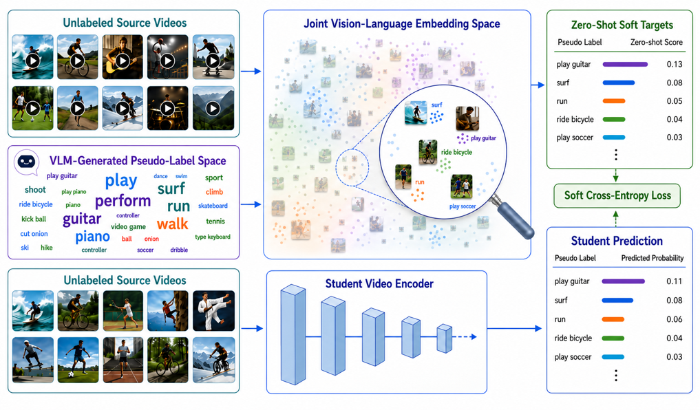

<h2 align="center">
LEViL: Label-Efficient Video Learning via Zero-Shot Distillation over VLM-Generated Pseudo-Label Spaces
</h2>

  

<h2>Model Checkpoints</h2>

Pretrained model checkpoints are available on
<a href="YOUR_GOOGLE_DRIVE_LINK">Google Drive</a>.

<h2>Citation</h2>

Coming soon.
